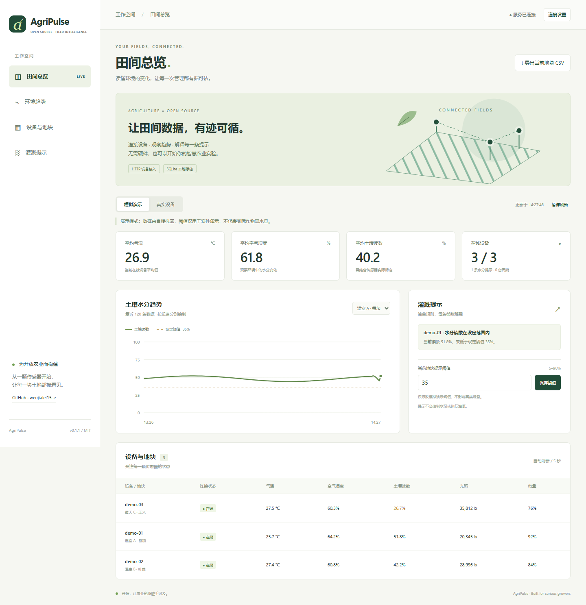
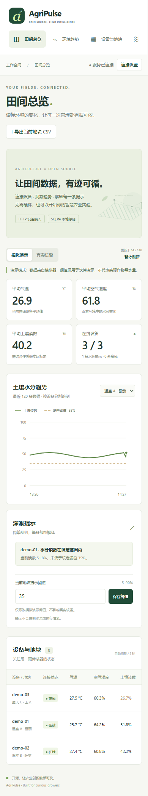

# AgriPulse 🌱

**让田间数据，有迹可循。** 一个支持模拟演示与真实设备接入的农业物联网开源项目。

AgriPulse is a hardware-optional agriculture IoT starter: a live dashboard, validated HTTP telemetry ingestion, SQLite history and explainable soil-moisture hints. Built with Python's standard library and vanilla JavaScript. No cloud account, frontend build or third-party runtime dependency required.

**状态：v0.1.1 / 可运行 MVP** · **维护者：[wenjialei15](https://github.com/wenjialei15)** · **协议：[MIT](LICENSE)**

[](https://github.com/wenjialei15/agripulse/actions/workflows/ci.yml)

## 为什么做这个项目

农业物联网入门常常卡在硬件、云平台配置或复杂部署上。AgriPulse 从可运行的最小链路出发：**采集 → 存储 → 可视化 → 可解释提示**。先用模拟器理解流程，再把模拟器换成自己的设备。

- **无需连接传感器，即可体验**：内置 3 个模拟地块，首次启动时生成约 1 小时的模拟历史数据，之后每 5 秒更新一次。
- **演示与现场明确分开**：切换“模拟演示 / 真实设备”，两种来源分别查询、导出和设置阈值，演示修改不会影响真实设备。
- **数据留在本机**：SQLite 持久化，启动时及每小时清理超过 30 天的读数，关闭模拟器后仍执行；可导出当前地块、当前来源最近 10000 条 CSV 数据。
- **设备身份独立保存**：历史读数过期后，设备仍显示为离线，地块与来源绑定继续保留，恢复上报后自动更新。
- **提示依据清晰**：每块地可单独设置水分阈值，页面展示触发原因；离线设备不生成灌溉提示。
- **支持真实设备接入**：提供带有数据校验的 JSON HTTP 上报接口和 Python 上报示例，ESP32 等设备可按相同协议对接。
- **中文响应式看板**：气温、空气湿度、土壤读数、光照、电量、在线状态与历史趋势。

## 30 秒启动

桌面看板（模拟数据）：



<details>
<summary>查看手机看板</summary>



</details>

需要 Python **3.9+**。建议使用仍受支持的 Python 版本，同时兼容使用 Python 3.9 的现有环境。运行核心功能无需安装第三方依赖。

```bash
git clone https://github.com/wenjialei15/agripulse.git
cd agripulse
python -m agripulse
```

浏览器打开 [http://127.0.0.1:8000](http://127.0.0.1:8000)。Windows 上如果 `python` 不可用，可将命令中的 `python` 换成 `py`。

首次启动会生成 3 个虚拟设备，默认土壤阈值为 35%。露天 C 的演示读数通常低于阈值，可以直接看到提示。

```bash
# 只接真实设备，关闭模拟器
python -m agripulse --no-simulator

# 自定义端口与数据库路径
python -m agripulse --port 8080 --db data/my-farm.db
```

## 上报一条设备数据

先启动服务，再打开第二个终端：

```bash
python examples/send_reading.py --once
```

在看板切换到 **真实设备**，选择 **温室 A**。不加 `--once` 会每 5 秒发送一条示例数据。这个脚本生成测试读数，真实传感器接入时需替换测量函数。

JSON 协议示例：

```json
{
  "zone_id": "greenhouse-a",
  "device_id": "esp32-01",
  "temperature": 25.6,
  "humidity": 68.2,
  "soil_moisture": 31.5,
  "light": 18600,
  "battery": 88
}
```

| 字段 | 范围 / 含义 |
| --- | --- |
| `zone_id` | `greenhouse-a`、`greenhouse-b`、`field-c` |
| `device_id` | 1–64 位字母、数字、`-`、`_`，以字母或数字开头；同一 ID 不可跨地块或来源复用 |
| `temperature` | -40–85 ℃ |
| `humidity` | 0–100% |
| `soil_moisture` | 0–100%，设备自行标定的相对读数 |
| `light` | 0–200000 lx |
| `battery` | 0–100% |

所有字段必填，不接受 NaN、Infinity、字符串或布尔值作为测量值。接收时间由服务器生成，设备提交的 `source` 和时间字段不会覆盖服务器记录。HTTP 接收的数据一律标记为 `device`。

## API

| 方法 | 路径 | 说明 |
| --- | --- | --- |
| GET | `/api/health` | 版本与模拟器状态，无需鉴权 |
| GET | `/api/summary?source=device` | 当前设备、在线状态、规则提示及地块阈值 |
| GET | `/api/history?zone=greenhouse-a&source=device` | 当前地块最近 120 条记录，按入库顺序返回 |
| GET | `/api/export.csv?zone=greenhouse-a&source=device` | 当前地块最近 10000 条记录，UTF-8 CSV |
| POST | `/api/telemetry` | 上报上述 JSON；成功返回 201 与记录 ID |
| POST | `/api/threshold` | `{"zone_id":"greenhouse-a","moisture_min":35,"source":"device"}`；范围 5–90，`source` 必填 |

查询参数 `source` 可用 `simulator` 或 `device`，默认 `simulator`。修改阈值必须在 JSON 中明确指定 `source`，缺少或无效时返回 400；遥测上报始终归入 `device`。写入时设置 `Content-Type: application/json`。API 错误返回 `{"error":"..."}` 和对应 HTTP 状态码。

汇总中的设备包含 `first_seen`、`last_seen` 和 `has_reading`。历史读数全部过期后，设备仍返回，`has_reading=false`、`online=false`，测量字段和 `recorded_at` 为 `null`，页面显示 `—`。`last_seen` 保留最后接收时间。

## 连接局域网设备

默认只监听 `127.0.0.1`。如果要监听其他网卡，需要设置至少 24 字符的随机 API key。示例 Python 上报程序会从同一环境变量读取密钥。

PowerShell：

```powershell
$env:AGRIPULSE_API_KEY = python -c "import secrets; print(secrets.token_urlsafe(32))"
python -m agripulse --host 0.0.0.0 --no-simulator
```

macOS / Linux：

```bash
export AGRIPULSE_API_KEY="$(python -c 'import secrets; print(secrets.token_urlsafe(32))')"
python -m agripulse --host 0.0.0.0 --no-simulator
```

设备请求发送 `Authorization: Bearer <你的密钥>`。浏览器点击“连接设置”输入同一密钥，密钥仅保留在当前页面内存中，刷新后重新输入。除 `/api/health` 外的所有 API 均受密钥保护，密钥拥有读写权限。

核心服务器定位为本地实验与教学工具，不是生产公网服务。跨网络部署应使用 HTTPS 反向代理、访问控制和速率限制；内置服务没有 TLS、用户权限分级或完整生产加固。不要将真实密钥、网络配置或农场数据库提交到 Git。

## 项目结构与架构

| 路径 | 职责 |
| --- | --- |
| `agripulse/core.py` | 数据校验、SQLite 存储、模拟器、阈值规则 |
| `agripulse/server.py` | HTTP API、鉴权、静态文件、独立历史清理与后台模拟任务 |
| `agripulse/static/` | 中文监测看板，原生 HTML / CSS / JavaScript |
| `examples/send_reading.py` | 可运行的 HTTP 设备上报示例 |
| `tests/` | 存储、规则与 HTTP 集成测试 |
| `docs/` | 路线图、API 使用补充与贡献方向 |

设备或模拟器写入同一存储层，以来源字段隔离；浏览器每 5 秒读取汇总和历史接口。各设备的趋势分别绘制，避免把不同设备的点拼成一条曲线。超过 60 秒未收到新数据即视为离线，离线读数不计入平均值。

## 从 v0.1.0 升级

先停止服务并备份数据库，再使用新代码启动。首次打开旧数据库时自动迁移：保留读数、从现有读数注册设备，并把原有地块阈值复制到两个模式；之后分别修改。已经被旧版删除的读数和设备信息无法恢复。迁移后的数据库不能直接交给旧版本使用。详细操作见 [升级说明](docs/UPGRADING.md)，变更见 [CHANGELOG.md](CHANGELOG.md)。

## 验证

```bash
python -m unittest discover -s tests -v
```

前端为原生 JavaScript。已安装 Node.js 时可额外检查语法：

```bash
node --check agripulse/static/app.js
```

可选浏览器回归测试：`npm ci`、`npx playwright install chromium`、`npm test`。它们仅为开发依赖；详见 [贡献指南](CONTRIBUTING.md#浏览器测试与截图)。

## 当前边界

- 阈值提示是软件规则演示，不是经农艺验证的灌溉模型，也不会操作水泵。
- 土壤百分比为相对读数，必须结合传感器、介质及现场条件标定；默认阈值不是作物推荐值。
- 地块当前在 `core.py` 的 `ZONES` 中定义，不支持页面增删地块。
- 告警为当前状态提示，未实现独立告警事件历史、短信或邮件通知。
- 当前支持 HTTP 接入；MQTT、LoRaWAN、MCP 和 AI 功能属于后续计划，尚未实现。
- 数据库备份应在停止服务后进行；支持 v0.1.0 数据库自动迁移，但没有自动备份或降级迁移。
- 设备身份会持续保留，尚无删除设备或调整地块绑定的管理界面。

## 一起完善它

欢迎贡献设备适配、标定流程、英文界面、测试或文档。请先阅读 [CONTRIBUTING.md](CONTRIBUTING.md) 和 [路线图](docs/ROADMAP.md)。

如果这个项目对你有帮助，欢迎 Star；如果你在田间使用，欢迎分享硬件型号、匿名示例数据与复现步骤。

## License

[MIT](LICENSE) © 2026 wenjialei15
